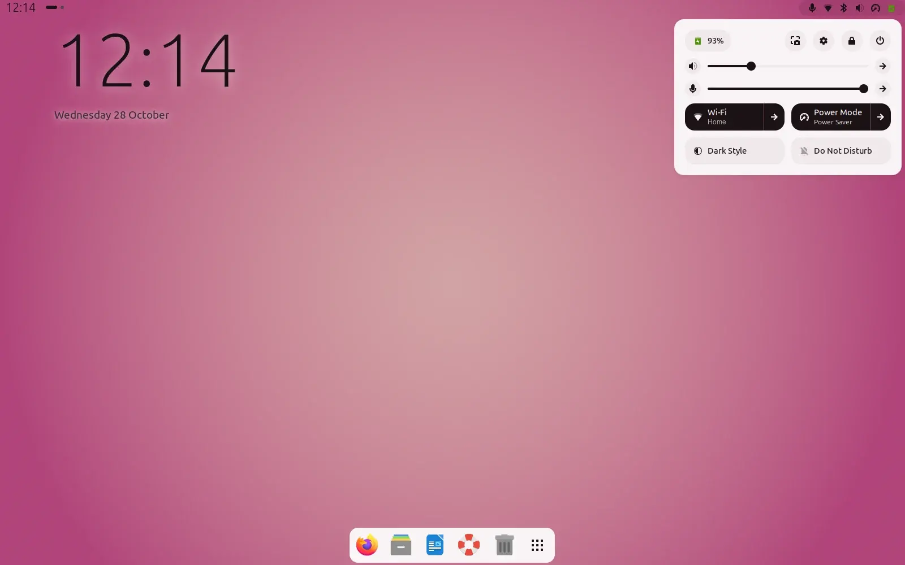
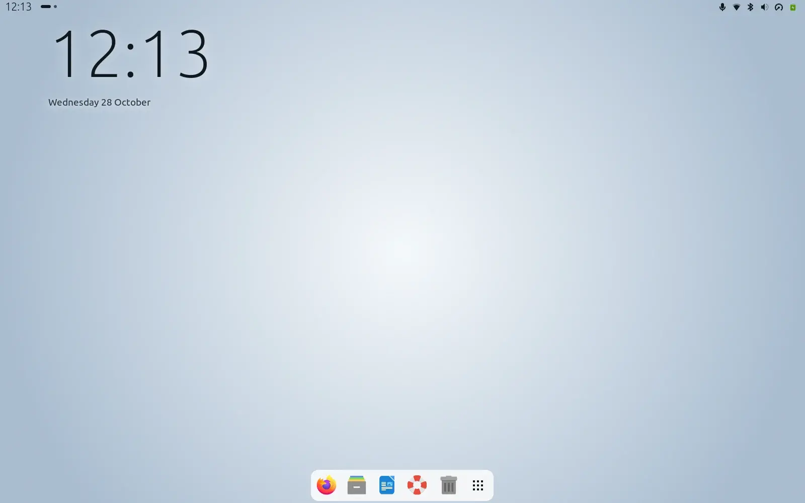
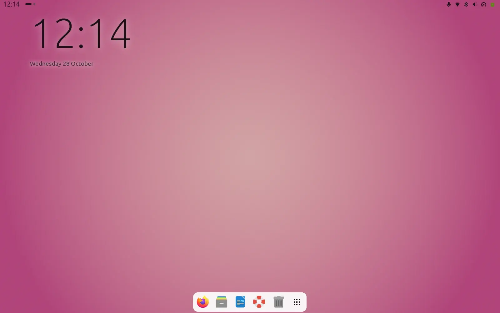
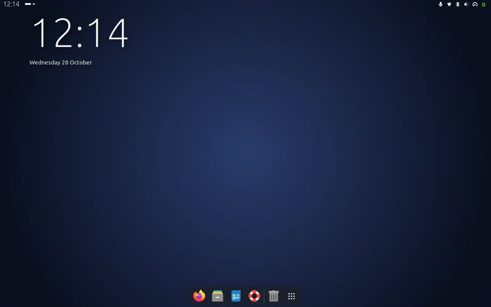
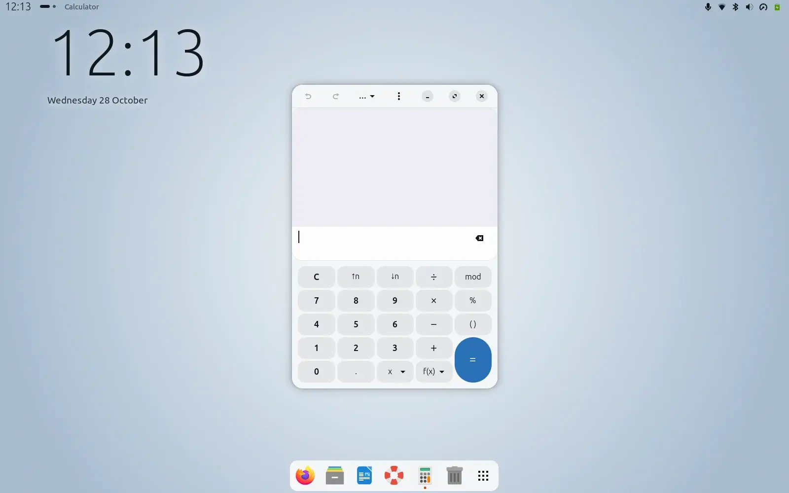
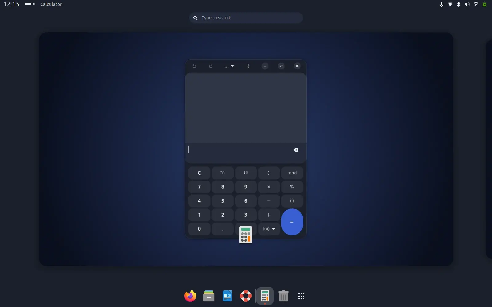
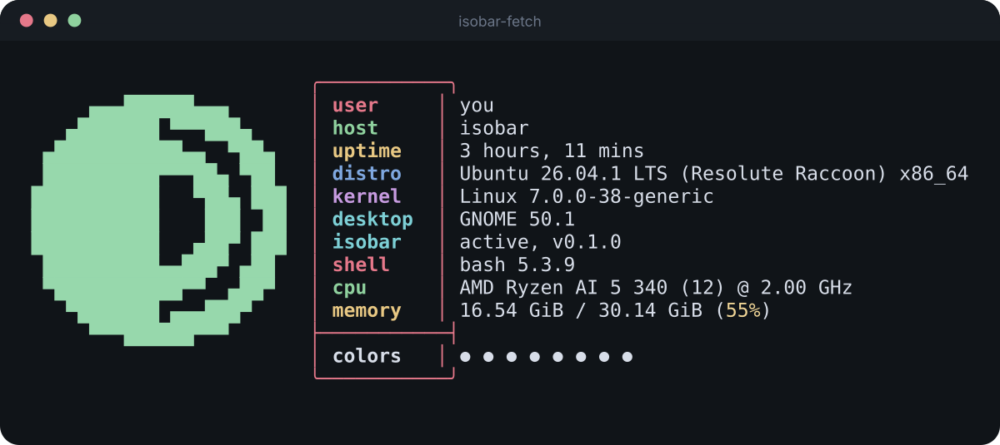
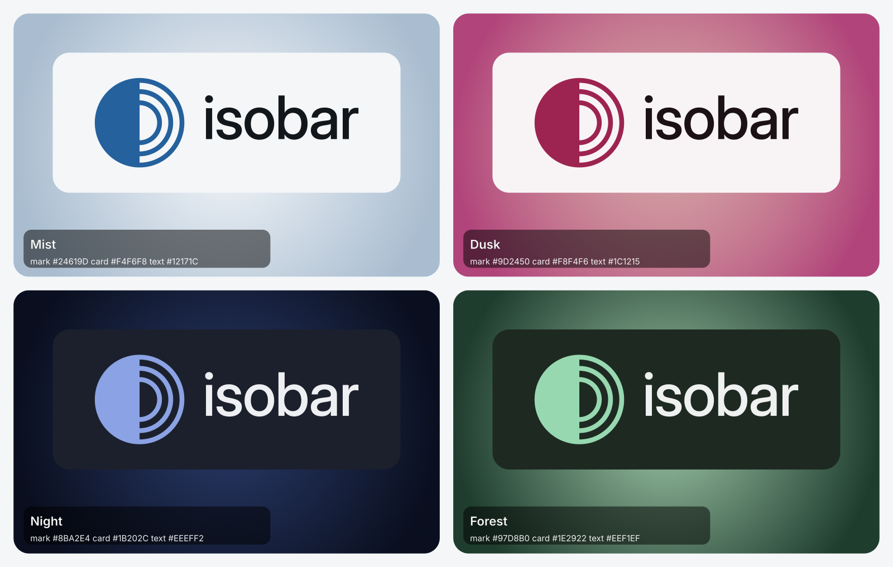

<p align="center">
  <picture>
    <source media="(prefers-color-scheme: dark)" srcset="brand/horizontal/isobar-horizontal-white.svg">
    
  </picture>
</p>

<p align="center"><b>The adaptive GNOME interface.</b><br>Your wallpaper picks the colours. Isobar does the rest.</p>

<p align="center">
  
  
  
  
</p>

<p align="center">
  <a href="https://captainpancakewithbacon.github.io/isobar/">Website and live demo</a> ·
  <a href="#install">Install</a> ·
  <a href="#what-it-changes">What it changes</a> ·
  <a href="#how-it-works">How it works</a> ·
  <a href="brand/GUIDELINES.md">Brand</a>
</p>

<p align="center">
  
</p>

Isobar is an extension for GNOME Shell 50. It reads your wallpaper, works out a palette from it, and restyles the shell, GNOME's own apps, the icons, the pointer, the dock and even the terminal logo to match. Change the wallpaper, or switch light and dark, and everything follows within a second.

There is no colour to pick, no theme to download and no network involved. The page [captainpancakewithbacon.github.io/isobar](https://captainpancakewithbacon.github.io/isobar/) runs the same palette code in your browser, so you can try it on any picture before installing anything.

## One picture, the whole desktop

The same extension on three different wallpapers. These are real screenshots from a headless GNOME Shell 50 session, not mock-ups.

| Mist | Dusk | Night |
| :---: | :---: | :---: |
|  |  |  |
| A pale wallpaper gives dark text and light cards. | The cards pick up the pink, softly. | A dark wallpaper flips everything to dark. |

## What you get

**The strip.** The top bar has no background of its own: the time, workspace dots and the app in front on the left, the stock quick settings on the right. It is pinned to 28 px. Its text is dark or light, whichever reads better on the top of your wallpaper, and a soft veil appears only when neither does. Activities and the date menu are hidden.

**A big clock.** On the desktop, under the windows, in the same light weight as the headline on the website. Its colour is read off the patch of wallpaper it sits on, so it stays legible on busy pictures.

**Cards.** The quick settings, menus, calendar, overview search, notifications and dialogs are cards in the wallpaper's hue: light with dark text on a pale picture, dark with light text on a dark one. Body text keeps at least 7 to 1 contrast against its card.

<table>
<tr>
<td width="50%"></td>
<td width="50%"></td>
</tr>
<tr>
<td><b>Your apps.</b> GNOME's own apps (Files, Settings, Calculator, Text Editor and the rest of the libadwaita family) get the wallpaper's colours and Isobar's shape language: soft radii, flat headers, round controls, thin sliders. Light and dark switch live, even in windows that are already open.</td>
<td><b>Overview and dock.</b> The overview, search and the dock sit on the same card colour. The dock is a floating pill that hides when windows get in its way.</td>
</tr>
</table>

**Small things that follow too**

- **Light or dark, automatically.** When the wallpaper changes, GNOME's light/dark preference follows its brightness, so GTK and libadwaita apps flip with it.
- **Icons and pointer.** If you use Papirus, it swaps between Papirus-Light and Papirus-Dark. The pointer goes DMZ-Black on light and DMZ-White on dark. Any other icon or cursor theme is left alone.
- **No grey flash.** GNOME paints a stock grey while it starts. On Ubuntu that colour is a setting, so Isobar keeps it at your wallpaper's average and the desktop fades in from a matching tone.
- **The dock comes along.** Position, hiding, icon size and opacity are part of Isobar. See [The dock](#the-dock).
- **Login screen.** An optional theme built from Ubuntu's own: your wallpaper darkened and blurred, no Ubuntu logo, a soft name card. See [Login screen](#login-screen).
- **Coucou.** If you run Coucou, its island can wear the card colour too. Opt-in. See [Coucou](#coucou).
- **The terminal.** The mark is a `fastfetch` logo in your wallpaper's accent colour. See [In the terminal](#in-the-terminal).

## Install

Isobar needs **GNOME Shell 50** on Wayland. It is written and tested on Ubuntu 26.04; the one Ubuntu-only part (the start-up colour) is skipped elsewhere.

```bash
git clone https://github.com/CaptainPancakeWithBacon/isobar.git
cd isobar
tools/install.sh               # links the extension into ~/.local/share/gnome-shell/extensions; enables nothing
# log out and back in once so the shell sees it, then:
gnome-extensions enable mist@gijs.dev
```

> The extension id is still `mist@gijs.dev`: that was the project's working name, kept so nothing has to be renamed or re-enabled.

**Before you enable it**

- If you use the User Themes extension, set the shell theme back to Default: Isobar recolours the shell itself and two themes would fight.
- If you use Blur My Shell, switch off its panel and popup styling. It overrides themes with `!important` rules.

**Undo**

```bash
gnome-extensions disable mist@gijs.dev      # restores the dock, removes the app colours
rm ~/.local/share/gnome-shell/extensions/mist@gijs.dev
```

## What it changes

Everything Isobar writes, in one place. Nothing else is touched.

| Where | What Isobar does |
| --- | --- |
| GNOME Shell | Hides Activities and the date menu, adds the clock, dots and app name to the bar, pins the bar to 28 px, loads one stylesheet. |
| `org.gnome.desktop.interface` | `color-scheme` follows the wallpaper's brightness when the wallpaper changes. `icon-theme` and `cursor-theme` swap only if you already use Papirus or DMZ. |
| `~/.config/gtk-4.0/` | Writes `mist.css` and adds one import line to your `gtk.css`. Disabling Isobar removes both and leaves the rest of your `gtk.css` alone. |
| `org.gnome.shell.extensions.dash-to-dock` | The dock profile: position, hiding, icon size, opacity. Remembered and restored. |
| `com.ubuntu.login-screen` | Ubuntu only: `background-color` is kept at the wallpaper's average. |
| `~/.cache/isobar/` | The current accent colour (for the terminal logo) and the dock settings you had before. |
| Coucou, opt-in | Only if `~/.config/mist/coucou` exists: Coucou's island colour, with one restart per change. |

GNOME also disables extensions while the screen is locked. Isobar does not undo the dock or the app colours then.

## The dock

Isobar carries the dock's behaviour and style with it, so the dock looks and acts the same wherever you run Isobar. When it is enabled it applies a profile to Ubuntu Dock / Dash to Dock:

| Setting | Isobar's value | Effect |
| --- | --- | --- |
| `dock-position` | `BOTTOM` | Dock at the bottom edge |
| `dock-fixed`, `extend-height` | off, off | A floating pill, not a full-width panel |
| `autohide`, `intellihide` | on, on | Hides when windows overlap it |
| `intellihide-mode` | `ALL_WINDOWS` | Any window triggers hiding |
| `hide-delay`, `show-delay`, `animation-time` | 0.2, 0.25, 0.2 s | Calm timing |
| `dash-max-icon-size` | 44 | Icon size |
| `background-opacity`, `transparency-mode` | 1.0, `FIXED` | Solid: the card colour comes from the wallpaper |
| `multi-monitor`, `show-apps-at-top`, `show-mounts`, `show-trash` | on, off, off, on | Layout |

Before it changes a setting, Isobar saves the old value to `~/.cache/isobar/dock-previous.json`. Disabling Isobar puts every one back. The oldest value always wins, so applying twice never overwrites what you had.

**Make it yours.** Put overrides in `~/.config/isobar/dock.json`. Unknown keys and values of the wrong type are ignored.

```jsonc
{ "autohide": false, "intellihide": false, "dock-fixed": true, "dash-max-icon-size": 56 }
```

To leave the dock completely alone: `{ "manage": false }`.

## How it works

No machine learning, no network. A small piece of tested arithmetic in [`extension/lib/palette.js`](extension/lib/palette.js), used by the extension, by the tests and by the website's demo.

1. **Sample.** The wallpaper is shrunk to a 48 by 30 thumbnail. Three regions are kept: all of it, the band under the bar, and the patch under the big clock. A wallpaper that cannot be read (a dynamic `.xml` one, a missing file) falls back to its flat background colour.
2. **Decide.** The hue is the circular mean of the saturated pixels, so grey pixels get no say. Light or dark comes from the picture's WCAG luminance. Cards, text, a muted tone and an accent follow, always tinted with that hue.
3. **Check.** Body text keeps at least 7 to 1 against its card; muted text and the accent at least 4.5 to 1; white on the accent stays readable. Bar and clock text pick dark or light by contrast on their own patch of wallpaper. Unit tests cover every hue.
4. **Apply.** One shell stylesheet (a generated copy of GNOME's own dark theme with the palette on top), one GTK stylesheet that holds both a light and a dark palette in `prefers-color-scheme` blocks, and the few settings listed above. It runs again whenever the wallpaper or the light/dark preference changes.

Libadwaita apps ignore GTK themes on purpose, so Isobar does not ship one. It recolours them the way they allow: named colours and CSS variables in `~/.config/gtk-4.0/gtk.css`. Because both palettes are in the same file, an open window follows a light/dark switch live.

## In the terminal

<p align="center"></p>

The mark is also a logo for `fastfetch`, drawn with half-block characters from the real symbol. `isobar-fetch` prints it in your wallpaper's accent colour (the extension writes it to `~/.cache/isobar/accent`).

```bash
mkdir -p ~/.local/share/isobar && cp brand/terminal/isobar-small.txt brand/terminal/isobar.txt ~/.local/share/isobar/   # once
install -m755 brand/terminal/isobar-fetch brand/terminal/isobar-status ~/.local/bin/
isobar-fetch            # small logo
isobar-fetch --big      # large logo
```

`isobar-status` adds a line that shows whether Isobar is running and which version (`active, v0.1.0`). `isobar-fetch` uses your own fastfetch config and only replaces the logo. To make it the permanent logo, or for a config without icon fonts, see [`brand/terminal/`](brand/terminal/README.md).

## Login screen

The login screen runs as a separate GNOME Shell session that extensions cannot reach, so it is a separate, optional step. `gdm/build.sh` builds a copy of Ubuntu's login theme with Isobar's overrides, and it installs as an `update-alternatives` entry next to Ubuntu's own, so going back is one command. It needs `sudo`; read the script and [`gdm/`](gdm/) first. It shows a snapshot of the wallpaper from when you built it: run it again after changing the wallpaper.

```bash
gdm/build.sh
sudo install -D -m644 gdm/build/gnome-shell-theme.gresource /usr/share/gnome-shell/theme/Mist/gnome-shell-theme.gresource
sudo update-alternatives --install /usr/share/gnome-shell/gdm-theme.gresource gdm-theme.gresource /usr/share/gnome-shell/theme/Mist/gnome-shell-theme.gresource 25

# undo
sudo update-alternatives --remove gdm-theme.gresource /usr/share/gnome-shell/theme/Mist/gnome-shell-theme.gresource
```

## Coucou

[Coucou](https://github.com/Louis-CFM/coucou) reads its island colour only at start-up. If `~/.config/mist/coucou` exists, Isobar writes the card colour into Coucou's `islandColor` and `islandCustomColor` whenever the palette changes, stops Coucou first (so it cannot overwrite the change when it quits), and starts it again with its own launcher. It never touches any other Coucou setting. Delete the marker file to turn it off.

## Tested

Everything runs without touching your session.

```bash
for t in tests/*.test.js; do gjs -m "$t"; done        # unit tests: palette, GTK stylesheet, dock profile, Coucou sync, site
MIST_WALLPAPER=/path/pale.png MIST_WALLPAPER_2=/path/dark.png tools/test.sh   # headless GNOME Shell 50 in ubuntu mode
tools/launcher-test.sh                                # search and app-grid launching in a throwaway shell
tools/gdm-test.sh                                     # the login stylesheet, rebuilt from the greeter's style names
```

The headless run loads the extension in a throwaway shell with its own D-Bus session, checks the strip, clock, bar height, dock, colours and restore path, changes the wallpaper and checks that everything follows, opens real apps, and saves screenshots. Every screenshot in this README comes from it (`tools/make_media.py`). The harness refuses to run on your real session bus.

## Repository

| Path | What |
| --- | --- |
| `extension/` | The extension. `lib/palette.js` is the heart; `shell-css.js`, `mist-css.js`, `gtk-css.js`, `gtk-shape.js` build the stylesheets; `dock*.js`, `coucou*.js`, `wallpaper.js`, `gtk.js` do the settings and files. |
| `tests/` | Unit tests, run with `gjs -m`. |
| `tools/` | Install, the headless test harness and its drivers, the packer for the listing edition, the screenshot and website builders. |
| `gdm/` | The optional login theme. |
| `brand/` | The logo, its size cuts, web icons, terminal logo, guidelines and a presentation board. |
| `docs/` | The website (GitHub Pages). `index.html` is generated by `tools/build_site.py`. |

## For extensions.gnome.org

`tools/pack_ego.py` builds a listing edition from the same source: no dock management and no Coucou sync (both reach into other software), every behaviour that changes settings outside the shell is a switch in a preferences window, and the system-wide ones are off until you turn them on. `tests/ego.test.js` checks the zip against GNOME's review guidelines. The checklist, the questions reviewers ask, and what is still open are in [docs/EXTENSIONS-GNOME-ORG.md](docs/EXTENSIONS-GNOME-ORG.md); a plain-language walk through the code is in [docs/CODE-TOUR.md](docs/CODE-TOUR.md). It has not been submitted yet.

## Status and limits

Early and personal. It has run on one laptop (Ubuntu 26.04, GNOME 50.1) and is checked by the tests above.

- **GTK3 apps** are not restyled yet; GTK4 and libadwaita apps are.
- **Blur My Shell** can override themes. Switch off its panel and popup styling.
- **Multi-Monitors Bar** adds bars on other monitors that Isobar does not style.
- **Text Editor and other GtkSourceView apps** keep their own editor colours.
- **The login theme** is a snapshot of the wallpaper from when it was built.
- **No trademark search** has been done for the name or the mark.

## Brand

The mark is a solid half disc whose other half dissolves into contour lines: light and dark in one shape, drawn with the lines of an isobar map. It has no colour of its own; in Isobar's interface it takes the wallpaper's accent.

<p align="center"></p>

Logo files, three size cuts, reversed versions, web icons and the guidelines are in [`brand/`](brand/GUIDELINES.md). This project continues the older contour-map Isobar, which lives on as [isobar-contour](https://github.com/CaptainPancakeWithBacon/isobar-contour).

## Licence

MIT. See [LICENSE](LICENSE). Papirus, DMZ, Inter and Ubuntu's login theme are not part of this repository and keep their own licences; the wordmark is outlined from Inter (SIL Open Font License).
