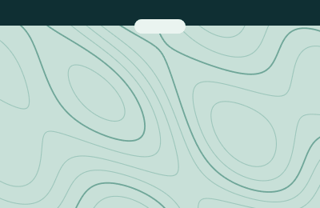
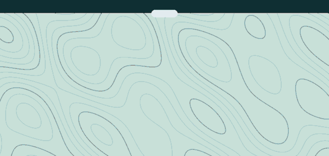
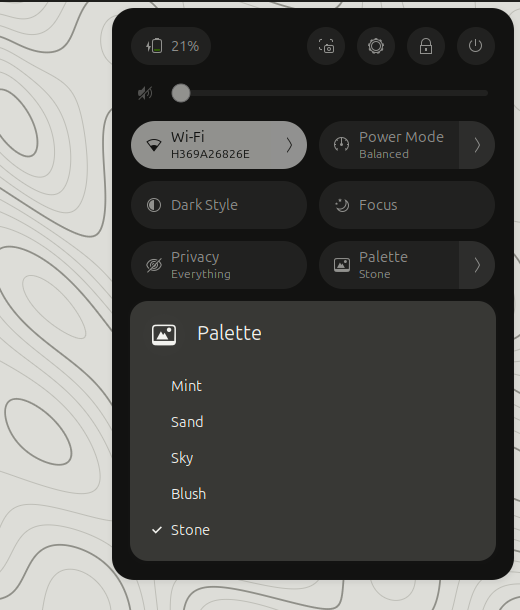
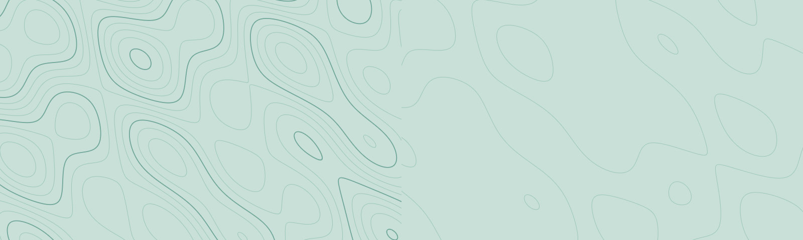

<p align="center">
  <picture>
    <source media="(prefers-color-scheme: dark)" srcset="brand/horizontal/isobar-horizontal-white.svg">
    
  </picture>
</p>

A quiet, light GNOME Shell extension. The desktop is a living contour map, the top bar is a thin ink strip, and a small pill under the bar opens for what matters: a notification, a song, an AI agent that needs you.

<p align="center">
  
</p>

## Features

- **The island.** A white pill under the bar. It opens for events, sends a ripple through the terrain (bigger for what matters more), and closes again. Rest the pointer on it to keep it open, click it to dismiss.
- **Notifications on the island.** App notifications show there instead of as GNOME's banner, and stay in the message list. A privacy toggle decides how much shows: everything, the title only, or just the app name.
- **Music.** When a media player starts a new song, the island shows the title and artist.
- **AI agents.** Claude Code, OpenCode and Copilot CLI can tell the island when they are done or need you, through a small relay. [Details below.](#ai-agent-hooks)
- **A contour desktop.** A shader draws contour lines behind your windows. The terrain drifts slowly, ripples when you switch workspace or open quick settings, and calms down in Focus mode.
- **Five light palettes.** Mint, sand, sky, blush and stone change the terrain, bar, menus and island together.
- **A different bar.** Workspace pills on the left (the current one is long), date and battery as one button that opens quick settings.
- **Quick settings in ink and paper**, with Focus, Privacy and Palette toggles.
- **Cheap when you are not looking.** The terrain hides while a window covers the screen and can be set to redraw rarely, or never, at rest.

<p align="center">
  
</p>

<p align="center">
  
  &nbsp;
  
</p>

## Status

An early, personal project. Be careful with it.

- Written for **GNOME Shell 46** and tested on Ubuntu 24.04 on **Wayland**, by automated checks in a headless shell and by hand on one laptop with one monitor.
- **Not tested:** X11, other GNOME versions, several monitors (a layer is made per monitor, but that has not been looked at), windows with transparency, and the lock screen.
- Light colours only. The overview, the dock and the message list are not restyled; notifications show on the island instead of as banners.
- Not on extensions.gnome.org.
- **It costs GPU while the terrain is visible.** On one AMD laptop, on battery in `power-saver`, an empty desktop at 10 fps used about 9 points more GPU, 4 to 5 points more CPU and roughly 0.6 W more than without Isobar. At 0 fps and while a window covers the screen the difference was not measurable. Blur my Shell's panel blur accounts for about 40 % of the visible cost if you use it. The numbers, and what did not help, are in [`docs/design.md`](docs/design.md).

## Requirements

- GNOME Shell 46 on Wayland
- `glib-compile-schemas` (package `libglib2.0-bin` on Ubuntu)

## Install

Until it is packaged, install it by linking the folder:

```bash
glib-compile-schemas schemas
ln -s "$PWD" ~/.local/share/gnome-shell/extensions/isobar@gijs.dev
```

On Wayland, log out and in once so the shell finds the extension. Then:

```bash
gnome-extensions enable isobar@gijs.dev
```

The shell keeps the code it loaded until the next login, so after changing a file you need to log in again to see it.

## Settings

How often the terrain redraws while nothing moves, from 0 to 30 (default 10). At 0 it stays still until something happens. This changes live:

```bash
dconf write /org/gnome/shell/extensions/isobar/idle-fps 5
```

The **Palette** menu in quick settings (or the `palette` key) picks the colours of the terrain, the bar, the menus and the island: mint (the default), sand, sky, blush or stone. All are light. The colours live in [`lib/palettes.js`](lib/palettes.js); the stylesheets in `palettes/` are generated from it with `gjs -m tools/gen-palettes.js`, and a test fails if they drift apart.

Focus is the toggle in quick settings. It is stored in `/org/gnome/shell/extensions/isobar/focus`.

## The island

A white pill hangs under the middle of the bar. Anything can send it an event over D-Bus: it opens, ripples the terrain, and closes again.

```bash
gdbus call --session --dest org.gnome.Shell --object-path /org/gnome/Shell/Extensions/Isobar --method org.gnome.Shell.Extensions.Isobar.Show "Build finished" "isobar took 2m 14s" done 5
```

The arguments are a title, a subtitle, a kind (`needs`, `error`, `done` or `info`) and the number of seconds (0 for the default of that kind). A more important kind takes over once the current event has been shown for 1.5 seconds; the others queue, up to eight. Titles are cut at 60 characters and subtitles at 90. The ripple grows with the kind.

App notifications open the island instead of GNOME's banner and stay in the message list. Critical ones count as "needs you", low-urgency ones stay off the island, as GNOME shows no banner for them either. Set `replace-banners` to false (`dconf write /org/gnome/shell/extensions/isobar/replace-banners false`) to get GNOME's banners back. The **Privacy** toggle in quick settings cycles how much a notification shows on the island: everything, title only, or the app name only. Events you send to the island yourself are always shown in full. When a media player (anything that speaks MPRIS) starts a new song, the island shows its title and artist; resuming the same song stays quiet. Resting the pointer on an open island keeps it open until you leave; a click dismisses it and moves on to the next event. Agent hooks are described below; the design is in [`docs/design.md`](docs/design.md). The island is new: it has automated checks but has not been used on a real desktop for any length of time. The title uses Big Shoulders Display if it is installed, then a condensed system font, then the default font; an extension cannot load a font of its own.

## AI agent hooks

An agent can tell the island when it is done or needs you. One small relay ([`hooks/relay.py`](hooks/relay.py)) turns an agent's hook into a call to the island's D-Bus method, and [`hooks/install.py`](hooks/install.py) sets the hook up. The hooks are not part of the extension itself; nothing is installed until you run the installer.

| Agent | Shows | Install | Status |
| --- | --- | --- | --- |
| Claude Code | needs you (`Notification`), done (`Stop`) | `python3 hooks/install.py claude` | tested end to end with the relay, not with a live Claude Code session |
| OpenCode | needs you (`permission.asked`), done (`session.idle`) | `python3 hooks/install.py opencode` | written from its plugin docs, untested |
| Copilot CLI | done (`sessionEnd`), error (`errorOccurred`) | `python3 hooks/install.py copilot --repo DIR` | written from the GitHub hooks docs, untested; unclear whether the CLI runs them |

`--remove` takes them away again, and only touches entries that mention `relay.py`. Agent events are always shown in full, whatever the privacy level. Other agents (Cursor, Gemini CLI, Codex) are not supported yet; the relay only needs a new line in its table once their hook format is known.

## Uninstall

```bash
gnome-extensions disable isobar@gijs.dev
rm ~/.local/share/gnome-shell/extensions/isobar@gijs.dev
dconf reset -f /org/gnome/shell/extensions/isobar/
```

Disabling puts the bar back. GNOME may briefly disable and enable the extensions that come after Isobar in your list when you toggle it.

## Coucou

Isobar is designed to sit next to [Coucou](https://github.com/Louis-CFM/coucou) (MIT), a small separate app that lives under the top bar. The island below the bar in the design and in the prototype is Coucou's; Isobar draws no island of its own, and it does not include or depend on Coucou. There is no integration yet, so the terrain does not ripple when Coucou expands. That is an open question in [`docs/design.md`](docs/design.md). Coucou is by Louis Raille, and its name, mascot and sounds belong to him.

## Development

Unit tests for the plain logic run under `gjs`:

```bash
gjs -m tests/bar.test.js
gjs -m tests/terrain.test.js
gjs -m tests/island.test.js
gjs -m tests/notifications.test.js
gjs -m tests/music.test.js
gjs -m tests/palettes.test.js
python3 hooks/test_relay.py
```

The shell itself is tested in a throwaway GNOME Shell that touches nothing of your session. A test-only extension in `tools/driver/` clicks through the bar, checks colours, the pill animation, the Focus setting, the redraw rate and the pausing under windows, and takes screenshots; two scripts then check the screenshots (no orange left in the menu, and the terrain on screen against the tested maths).

```bash
mkdir -p /tmp/isobar-run
ISOBAR_HEADLESS=1 ISOBAR_DRIVER_OUT=/tmp/isobar-run tools/nested.sh --drive
```

It needs `gnome-shell` 46, `gjs`, GTK 4, Python 3 with Pillow, and takes about two minutes. Without `ISOBAR_HEADLESS` it opens a nested window instead, but then your own mouse can disturb the clicks. `tools/measure.sh` averages GPU use, battery power and shell CPU over a number of seconds, and changes nothing.

The animations in this README are made from real frames of the test shell: run the driver with `ISOBAR_ONLY=demo` (without `ISOBAR_HEADLESS`: the headless shell plays animations about ten times too fast, so a window opens for about 40 seconds), then `python3 tools/make_gifs.py <output dir> docs/media`.

`tools/pack.sh` builds the zip for extensions.gnome.org and checks what is in it; what is left before a release is in [`docs/releasing.md`](docs/releasing.md).

## Prototype

[`prototype/index.html`](prototype/index.html) is the design in a browser, with no build step: click the workspace pills, the date and battery, or anywhere on the terrain. The two buttons at the bottom stand in for Coucou.

## Logo

Files and rules are in [`brand/`](brand/GUIDELINES.md).

## License

MIT, see [`LICENSE`](LICENSE). The prototype loads Big Shoulders Display and Schibsted Grotesk from Google Fonts, both under the SIL Open Font License. The wordmark is drawn from Inter Display, also under that licence.
